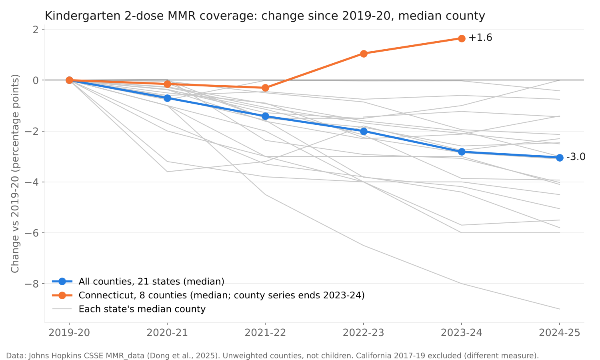
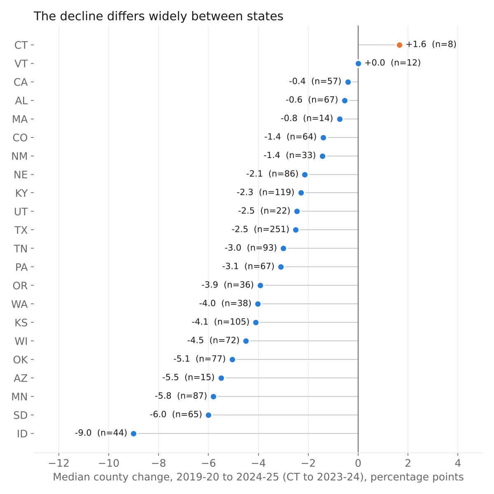

<div dir="rtl">

# כיסוי חיסוני MMR בגן חובה ברמת המחוז בארה"ב: לפני הקורונה ואחריה

עברית | [English](README.md)

פרויקט ניתוח נתונים של אשד לין, אפידמיולוג. השאלה: מה קרה לשיעור הילדים בגן חובה שקיבלו שתי מנות MMR, ברמת המחוז, מ-2019-20 ועד 2024-25? ומה אפשר ואי אפשר לומר על קונטיקט, שביטלה ב-2021 את הפטורים שאינם רפואיים?

הערך המרכזי של הפרויקט הוא לא רק הממצא, אלא שיטת העבודה: החלטות שתועדו לפני התוצאות, שני סבבי ביקורת עמיתים בלתי תלויים, ותיקון של טעויות בנתונים ובמסקנות לפני פרסום.

## ממצאים עיקריים

בניתוח 1,432 מחוזות ב-22 מדינות שמודדות את אותו מדד (2 מנות MMR, גן חובה, יחידה מחוזית). רווחי סמך של 95% מדגימה חוזרת של מדינות שלמות.

| מדד | אומדן | רווח סמך |
|---|---|---|
| חציון השינוי במחוז | ירידה של 3.0 נקודות אחוז | 2.3 עד 3.9 |
| מחוזות מתחת ל-2019-20 | 81.4% | 76.2% עד 85.5% |
| מחוזות שירדו בנקודה או יותר | 73.0% | 65.9% עד 79.4% |
| מחוזות שירדו בשתי נקודות או יותר | 62.3% | 54.2% עד 69.7% |

- **אין התאוששות:** הפער מ-2019-20 גדל בכל שנה (0.7, 1.4, 2.0, 2.8, 3.0 נקודות).
- **הירידה לא אחידה:** חציון המחוזות נע מירידה של 9.0 נקודות באיידהו ועד 0 בוורמונט (מלבד קונטיקט). גם בתוך מדינות יש הבדלים אמיתיים בין מחוזות, אבל רעש המדידה בגודל דומה, ולכן אי אפשר לסווג מחוז בודד באמינות.
- **קונטיקט:** אף אחד מ-8 המחוזות לא נמצא מתחת ל-2019-20 ב-2023-24 (חציון עלייה של 1.65 נקודות, לעומת ירידה של 2.8 במדינות האחרות באותו חלון). העלייה מתחילה ב-2022-23, כשפג תוקף הפטורים של ילדי הגן הקדם-חובה. זהו מקרה תיאורי של מדינה אחת, שמתיישב עם השפעה של החוק אבל אינו מוכיח אותה.





## הנתונים

- **מקור:** Johns Hopkins CSSE, מאגר [MMR_data](https://github.com/CSSEGISandData/MMR_data). הנתונים לא נשמרים במאגר הזה, כי למאגר המקור אין קובץ רישיון. הסקריפט `get_data.py` מוריד אותם.
- **בחירת מדינות:** רק מדינות שמודדות 2 מנות MMR בגן חובה ברמת המחוז (30 מדינות). בשמונה מהן אין אף מחוז עם ערך ב-2019-20 וב-2024-25, ולכן נשארות 22.
- **בעיות שנמצאו ותוקנו:** ערכים עם כוכבית (שיטה אחרת) הוסרו; מזהי מחוז בני 4 ספרות תוקנו; בקונטיקט הסדרה המחוזית נגמרת ב-2023-24; בקליפורניה הערכים של 2017-18 ו-2018-19 אינם נתוני 2 מנות MMR (לפי דוח משרד הבריאות של המדינה) והוסרו. הרשימה המלאה ב-`verification.md`.

## שיטה

- **תוצא ראשי:** השינוי בכל מחוז בין 2019-20 ל-2024-25 (בקונטיקט 2023-24), בנקודות אחוז.
- **אי-ודאות:** דגימה חוזרת של מדינות שלמות, כי מחוזות באותה מדינה אינם בלתי תלויים.
- **בדיקות:** השמטת מדינה אחת בכל פעם; בסיס חלופי בקולורדו; השמטת מדינות עם בעיות דיווח מתועדות; שקלול לפי מדינה; סיום ב-2023-24 לכולם.
- **ניתוח משני:** סיווג המחוזות לארבע קבוצות (ירידה שלא התאוששה, ירידה והתאוששות, עלייה, יציב). השיעורים תלויים מאוד בסף (ירידה שלא התאוששה: 73% בסף של נקודה, 51% בסף של 3 נקודות), ולכן הם תיאוריים בלבד.
- **קונטיקט:** השוואה מותאמת לרמה ההתחלתית מול כל מדינה אחרת. קונטיקט במקום הראשון מתוך 20 מדינות, וזו התוצאה החזקה ביותר שהמבחן הזה יכול להראות (p = 0.05). אין רווח סמך, כי לא ניתן לחשב אותו באופן תקף ממדינה אחת.

## מגבלות

- **מחוזות ולא ילדים:** יש רק שיעורים, בלי מונה ומכנה. מחוז קטן שווה למחוז גדול, וחציון מחוזות אינו שיעור הילדים.
- **ייצוג:** 22 מדינות נבחרו לפי זמינות נתונים, לא במדגם. מחוזות קטנים מושמטים יותר.
- **דיווח שונה בין מדינות:** סקרי בתי ספר, רישומים, מדגם רשות (אוקלהומה), ותקרה של 95% בוורמונט ובוויסקונסין.
- **הבסיס בטנסי** שוקלל על ידי מחברי המאגר ולא על ידי המדינה.
- **סיבתיות:** הניתוח תיאורי. ברמת המדינה כבר נמצא קשר בין ביטול הפטורים לעלייה בכיסוי (Bald et al., 2025), והפרויקט הזה לא מוסיף זיהוי סיבתי.

## איך לשחזר

<div dir="ltr">

```
pip install pandas numpy matplotlib
python get_data.py data
python analysis.py data out
python make_figures.py out
```

</div>

## קבצים

| תוכן | קובץ |
|---|---|
| הורדת הנתונים מהמקור | `get_data.py` |
| כל הניתוח, מהנתונים הגולמיים ועד הטבלאות | `analysis.py` |
| הגרפים | `make_figures.py` |
| כל החלטה, מי קיבל אותה ולמה | `decisions.md` |
| שחזור, שני סבבי ביקורת, יומן תיקונים ומה לא אומת | `verification.md` |
| גרסאות הבקשה למודל והציונים שלהן | `prompt.md` |
| הסקריפטים של הסוקרים, לשחזור הבדיקות | `review_scripts/` |
| טבלאות התוצאה והגרפים | `out/` |

## מקורות

<div dir="ltr">

Bald, A., Gold, S., & Yang, Y. T. (2025). State repeal of nonmedical vaccine exemptions and kindergarten vaccination rates. *JAMA Pediatrics*. https://doi.org/10.1001/jamapediatrics.2025.4185

Dong, E., Saiyed, S., Nearchou, A., Okura, Y., & Gardner, L. M. (2025). Trends in county-level MMR vaccination coverage in children in the United States. *JAMA*. https://doi.org/10.1001/jama.2025.8952

Johns Hopkins University Center for Systems Science and Engineering. (2026). *MMR_data* [Data set]. GitHub. https://github.com/CSSEGISandData/MMR_data

</div>

</div>
