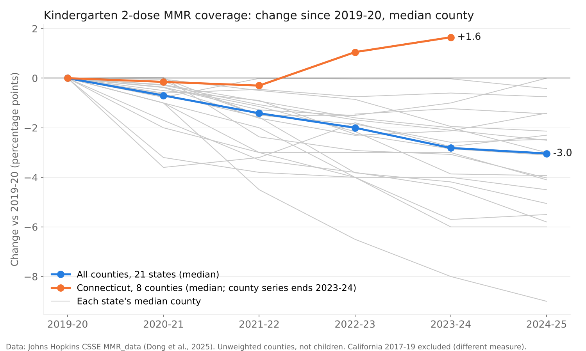
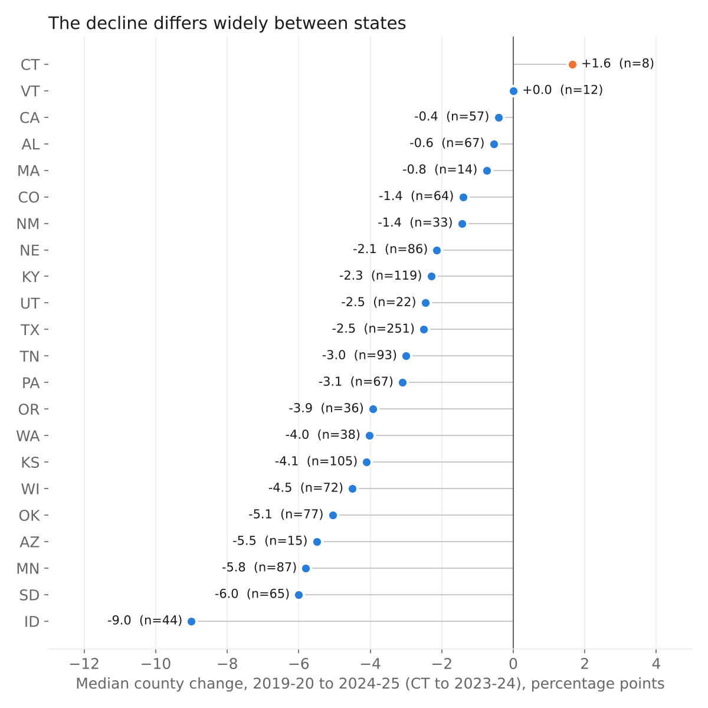

# Kindergarten MMR coverage by US county, before and after COVID-19

English | [עברית](README.he.md)

A data analysis project by Eshed Lin, epidemiologist. The question: what happened to the share of kindergartners with two doses of MMR vaccine, at county level, from 2019-20 to 2024-25? And what can, and cannot, be said about Connecticut, which repealed non-medical exemptions in 2021?

The main value of the project is the working method, not only the finding: design decisions recorded before results, two rounds of independent peer review, and data and reasoning errors corrected before publication.

## Main findings

1,432 counties in 22 states that measure the same thing (2-dose MMR, kindergarten, county unit). 95% confidence intervals from resampling whole states.

| Measure | Estimate | 95% CI |
|---|---|---|
| Median county change | −3.0 percentage points | −3.9 to −2.3 |
| Counties below 2019-20 | 81.4% | 76.2% to 85.5% |
| Counties down 1 point or more | 73.0% | 65.9% to 79.4% |
| Counties down 2 points or more | 62.3% | 54.2% to 69.7% |

- **No recovery:** the gap from 2019-20 widened every year (−0.7, −1.4, −2.0, −2.8, −3.0 points).
- **The decline is not uniform:** state medians range from −9.0 points (Idaho) to 0 (Vermont), apart from Connecticut. Counties also differ within states, but measurement noise is of similar size, so single counties cannot be classified reliably.
- **Connecticut:** none of its 8 counties was below 2019-20 in 2023-24 (median +1.65 points, vs −2.8 elsewhere over the same window). The rise starts in 2022-23, when exemptions for pre-kindergarten children expired. This is a descriptive single-state case, consistent with an effect of the law but not evidence of one.





## Data

- **Source:** Johns Hopkins CSSE, [MMR_data](https://github.com/CSSEGISandData/MMR_data) repository. The data are not stored here because the source repository has no licence file; `get_data.py` downloads them.
- **State selection:** only states that report 2-dose MMR for kindergarten at county level (30 states). Eight have no county with values in both 2019-20 and 2024-25, leaving 22.
- **Problems found and handled:** starred values (different method) removed; 4-digit county FIPS codes fixed; Connecticut's county series ends in 2023-24; California's 2017-18 and 2018-19 values are not 2-dose MMR data (checked against the state health department's report) and were removed. Full list in `verification.md` (Hebrew).

## Method

- **Primary outcome:** each county's change between 2019-20 and 2024-25 (Connecticut: 2023-24), in percentage points.
- **Uncertainty:** resampling whole states, because counties in the same state are not independent.
- **Checks:** leave one state out; alternative Colorado baseline; dropping states with documented reporting issues; state-weighted estimates; ending in 2023-24 for all states.
- **Secondary analysis:** classifying counties into four trajectories (declined and not recovered, dipped and recovered, rose, stable). The shares depend heavily on the threshold (not recovered: 73% at a 1-point threshold, 51% at 3 points), so they are descriptive only.
- **Connecticut:** baseline-adjusted comparison against each other state. Connecticut ranks first of 20 states, which is the strongest result this test can show (p = 0.05). No confidence interval is given, because none can be computed validly from a single treated state.

## Limitations

- **Counties, not children:** only rates are available, with no numerators or denominators. A small county counts as much as a large one, and a median of counties is not a rate among children.
- **Representativeness:** the 22 states were selected by data availability, not sampled. Small counties are suppressed more often.
- **Reporting differs between states:** school surveys, registries, an optional survey (Oklahoma), and values capped at 95% (Vermont, Wisconsin).
- **Tennessee's baseline** was weighted by the dataset authors, not by the state.
- **Causality:** the analysis is descriptive. A state-level association between exemption repeal and higher coverage has already been reported (Bald et al., 2025); this project adds no causal identification.

## Reproduce

```
pip install pandas numpy matplotlib
python get_data.py data
python analysis.py data out
python make_figures.py out
```

## Files

| File | Content |
|---|---|
| `get_data.py` | Downloads the source data |
| `analysis.py` | The full analysis, from raw data to result tables |
| `make_figures.py` | The figures |
| `decisions.md` | Every decision, who made it and why (Hebrew) |
| `verification.md` | Reproduction, two review rounds, correction log, what was not verified (Hebrew) |
| `prompt.md` | Versions of the prompt to the model and their scores (Hebrew) |
| `review_scripts/` | The reviewers' scripts, to reproduce the checks |
| `out/` | Result tables and figures |

## References

Bald, A., Gold, S., & Yang, Y. T. (2025). State repeal of nonmedical vaccine exemptions and kindergarten vaccination rates. *JAMA Pediatrics*. https://doi.org/10.1001/jamapediatrics.2025.4185

Dong, E., Saiyed, S., Nearchou, A., Okura, Y., & Gardner, L. M. (2025). Trends in county-level MMR vaccination coverage in children in the United States. *JAMA*. https://doi.org/10.1001/jama.2025.8952

Johns Hopkins University Center for Systems Science and Engineering. (2026). *MMR_data* [Data set]. GitHub. https://github.com/CSSEGISandData/MMR_data
